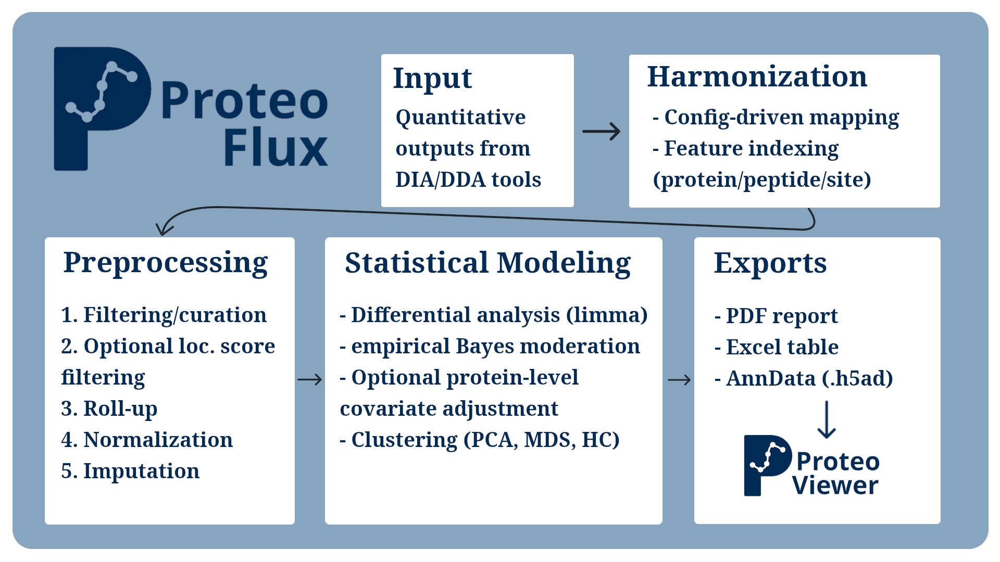

# ProteoFlux
[](https://doi.org/10.5281/zenodo.18640998)

ProteoFlux is an open-source Python framework for transparent, reproducible downstream analysis of quantitative proteomics data.

It operates on quantitative outputs generated by upstream search and quantification tools and provides a unified workflow for:

- Protein-centric proteomics  
- Peptide-centric analyses  
- Phosphoproteomics (with optional protein-level covariate adjustment)  
- PELSA analyses  

ProteoFlux emphasizes:

- Explicit data semantics  
- Transparent preprocessing  
- Explicit statistical models and testing scopes
- Seeded stochastic methods and inspectable outputs

---

## Overview



ProteoFlux takes a single YAML configuration file and produces:

- Harmonized and preprocessed quantification data
- Differential expression using the InMoose implementation of limma; separate 4PL dose-response fitting for PELSA
- Optional KSEA or PhosX kinase activity analysis for phosphoproteomics
- Principal component analysis (PCA), multidimensional scaling (MDS), and hierarchical clustering
- An optional structured multi-page PDF report
- Portable `.h5ad` files compatible with [ProteoViewer](https://github.com/Afanc/proteoviewer)
- Optional summary tables in Excel

---

## Installation

Python ≥ 3.10 is required by the pinned core dependencies and package metadata.
The automated test environments use Python 3.11 and 3.13; Python 3.10 is not
covered by that matrix. Use a dedicated environment, preferably Python 3.11 or
3.13. The scientific reference environment is listed in `tests/constraints.txt`.

PhosX is pinned to 0.23.1 because ProteoFlux uses its version-specific interfaces.
Keep the dependency versions, configuration, input ordering and random seeds
when reproducing results; a seed alone does not make results independent of
input order or dependency changes.

### Install from source (recommended)

```bash
git clone https://github.com/afanc/proteoflux.git
cd proteoflux
python -m pip install -e .
```

This installs ProteoFlux in editable mode.

---

## Quickstart (CLI)

List available configuration templates:

```bash
proteoflux templates
```

Create a template:

```bash
proteoflux init spectronaut-proteomics --path config.yaml
```

Edit paths, column mappings and analysis settings before running. Relative paths
resolve from your current working directory, not from the YAML file’s directory.
Template choices can differ from runtime defaults; see the configuration guide.

Run the pipeline:

```bash
proteoflux run --config config.yaml
```

---

## Output Files

| File | Description |
|------|------------|
| `*.h5ad` | Required output: processed values in `X`, raw/log/normalized layers, statistics, evidence and metadata |
| `*.xlsx` | Optional summary and evidence tables; curve results for PELSA |
| `*.pdf` | Optional multi-page QC and analysis report |

See [output semantics](docs/RESULTS.md) for matrix axes, missingness and the meaning
of “raw.” Preserve the original input files and YAML separately.

The `.h5ad` files are compatible with [ProteoViewer](https://github.com/Afanc/proteoviewer), an interactive visualization tool for ProteoFlux outputs.

---

## Using ProteoFlux as a Python Library

ProteoFlux can also be used programmatically:

```python
import yaml
from proteoflux.main import run_pipeline

with open("config.yaml") as stream:
    config = yaml.safe_load(stream)  # or supply a dictionary
run_pipeline(config)
```

This allows:

- Integration into larger workflows
- Batch processing
- Use inside Jupyter notebooks
- Custom downstream analysis of AnnData objects

The library accepts the same configuration dictionary as the CLI.
`run_pipeline` writes the configured outputs and returns `None`. Read the saved
object with `anndata.read_h5ad(...)` for downstream work. To obtain preprocessing
results only, use `proteoflux.workflow.dataset.Dataset(**config).get_anndata()`;
this does not run differential/kinase/PELSA analysis or export results.

---

## Configuration

All parameters are defined in a single YAML configuration file. We recommend starting with a template:

```bash
proteoflux templates
proteoflux init TEMPLATE_NAME
```

Full parameter reference:

See the configuration guide [docs/CONFIGURATION.md](docs/CONFIGURATION.md).

---

## Examples

Runnable, reduced example datasets and matching configs are provided under `examples/`:

- `examples/searle_small/`: small DIA proteomics example (Spectronaut export subset)
- `examples/phospho_small/`: phosphoproteomics example with an injected flow-through covariate run (Spectronaut export subsets)
- `examples/pelsa_small/`: small pelsa analysis example (Spectronaut export subsets)

Each example folder contains a `README.md` with a minimal command to run the pipeline (typically `proteoflux run --config <config>.yaml`) and the required input files (data + annotation, if applicable).

---

## Paper

The manuscript source is provided as [paper.md](paper.md).

---

## License

ProteoFlux is released under the MIT License. See the LICENSE file for details.

---

## Citation

If you use ProteoFlux in your work, please cite:

ProteoFlux (latest version).  
Zenodo. https://doi.org/10.5281/zenodo.18640998
